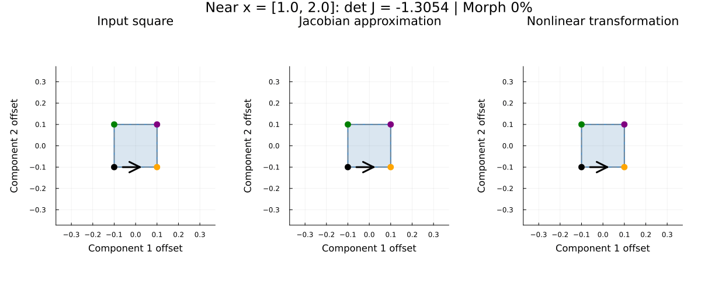

# Jacoby: Jacobian Matrices in Julia

Welcome to **Jacoby**, a demonstration of the natural synergy between Jacobian matrices and the Julia programming language.

## Introduction

Jacobian matrices are central to multivariate calculus, optimization, and scientific computing. Julia, with its high-performance numerical capabilities and expressive syntax, is an ideal language for exploring and computing Jacobians.


## Historical Lineage: Jacobi & French Mathematics

### Who is Jacobi?
Carl Gustav Jacob Jacobi (1804–1851) was a German mathematician renowned for his contributions to analysis, mechanics, and especially matrix calculus. The Jacobian matrix, named after him, is a fundamental concept in differential calculus and underpins much of modern scientific computation.

### What Made French Mathematics Special?
During the 18th and 19th centuries, French mathematicians such as Joseph Fourier, Pierre-Simon Laplace, and Évariste Galois revolutionized mathematics with their rigorous approach, creativity, and foundational work in analysis, algebra, and geometry. The French school emphasized clarity, abstraction, and generality, influencing mathematical thought worldwide and laying the groundwork for modern calculus and matrix theory.

France was a leading center for mathematical innovation during this period, with institutions like the École Polytechnique fostering groundbreaking research and education. The country’s reputation for excellence attracted talent from across Europe, making French mathematics a magnet for aspiring mathematicians and a model for rigorous scientific inquiry.

### Jacoby Demo
Jacoby is a simple demo project that showcases how Julia’s modern language features and rich ecosystem make working with Jacobian matrices intuitive and efficient.

### Julia Language Lineage
Julia was created to address the needs of scientific computing, combining the speed of C with the usability of Python and Matlab. Its lineage includes influences from mathematical and technical computing languages, making it a natural fit for matrix calculus and advanced numerical methods.

## Demo
See `jacoby_demo.jl` for a hands-on example of computing Jacobians in Julia using finite differences.

Install the project dependencies once, then run the demo:

```sh
julia --project=. -e 'using Pkg; Pkg.instantiate()'
julia --project=. jacoby_demo.jl
```

The script prints the function value and Jacobian and saves `jacobian_heatmap.png`
beside the script. The heatmap labels each derivative, with output components as
rows and input variables as columns. Blue indicates negative derivatives, red
indicates positive derivatives, and white marks zero on a symmetric color scale.
It can run from a shell without a graphical display.

The script also saves `jacobian_orientation.gif`, comparing a square of side
length 0.2 centered at `[1, 2]`, its Jacobian approximation, and its nonlinear
image. Arrows and matching corner colors show the boundary changing from
counterclockwise to clockwise because the Jacobian determinant is approximately
-1.3054. The linear map scales area by approximately 1.3054.

The panels display offsets from the input center and the output center `f([1, 2])`,
so translation does not obscure the shape change. Dashed outlines mark the
original square. Intermediate frames interpolate between the input offsets and
the transformed offsets; they are an illustration, not repeated applications of
the function or a physical evolution. The Jacobian image is a parallelogram,
whereas the nonlinear image has slightly curved edges.



---

For more information about Julia, visit [julialang.org](https://julialang.org/).
